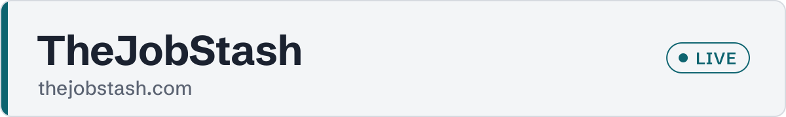
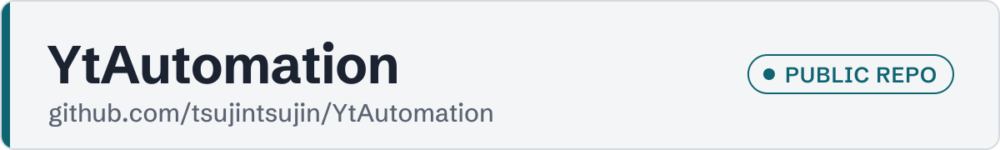

<picture>
  <source media="(prefers-color-scheme: dark)" srcset="assets/banner-dark.svg">
  
</picture>

Hi, I'm Justin. Full stack developer, based in Davao de Oro, Philippines, and I work remote.

I spent three years at Trade Dynamics building Amazon QuickSight dashboards and the MySQL feeds behind them, for national FMCG and pharma suppliers who ran their field sales off them. On my own time I build whole products start to finish. Two are live right now.

Before coding I taught college IT classes, did remote client support for a clinic in Australia and drew vector art for a company in Singapore. So I do design too, and I'm fine talking to clients.

### Live now

<a href="https://thejobstash.com">
  <picture>
    <source media="(prefers-color-scheme: dark)" srcset="assets/thejobstash-dark.svg">
    
  </picture>
</a>

Upload your resume and get a scored digest of jobs that fit. Payments go through PayMongo QR Ph. 
Next.js on Cloudflare Workers + D1 · Python scorer · Google sign-in

<a href="https://tapndine.online">
  <picture>
    <source media="(prefers-color-scheme: dark)" srcset="assets/tapndine-dark.svg">
    
  </picture>
</a>

NFC and QR table menus and ordering for restaurants in the Philippines, on top of the POS they already have. 
Next.js · Cloudflare D1 · staff side installs as a PWA

### On GitHub

<a href="https://github.com/tsujintsujin/YtAutomation">
  <picture>
    <source media="(prefers-color-scheme: dark)" srcset="assets/ytautomation-dark.svg">
    
  </picture>
</a>

Makes faceless narrated YouTube videos. I give it a topic and n8n does the voice, images, subtitles and final MP4 without me. Free tools only, voice runs locally. 
n8n · Python · Chatterbox TTS · Gemini · OpenCut

### Stack

**Front end** &nbsp; Next.js · React · TypeScript · Tailwind CSS · GSAP · React Native and Expo 
**Back end** &nbsp; Node.js · NestJS · Python · PHP · Laravel · CakePHP 
**Data and BI** &nbsp; Amazon QuickSight · MySQL · PostgreSQL · Cloudflare D1 · Supabase · Prisma 
**AI** &nbsp; Claude API · Workers AI · Ollama · Claude Code 
**Automation** &nbsp; n8n · Slack apps · Meta Graph API · PayMongo · Playwright 
**Cloud** &nbsp; Cloudflare Workers · Vercel · Docker Compose 
**Design** &nbsp; Figma · Photoshop · Illustrator · After Effects

---

[justin94.space](https://justin94.space) &nbsp;·&nbsp; [LinkedIn](https://www.linkedin.com/in/justin-m-992772236)
